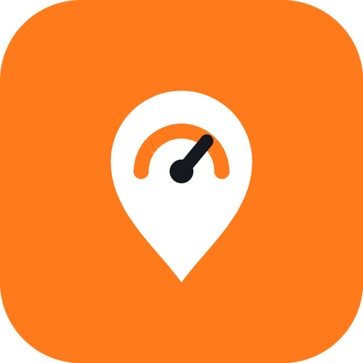

<h1 align="center">Telemet</h1>

<b>DJI Osmo Action kameralar için ücretsiz GPS telemetrisi. DJI GPS Bluetooth kumandası yerine Android telefonunu kullan.</b>

[English](docs/README.en.md) · **Türkçe** · [Español](docs/README.es.md) · [Français](docs/README.fr.md) · [Italiano](docs/README.it.md) · [Deutsch](docs/README.de.md) · [Português](docs/README.pt-BR.md) · [简体中文](docs/README.zh-CN.md) · [日本語](docs/README.ja.md) · [한국어](docs/README.ko.md) · [Русский](docs/README.ru.md) · [العربية](docs/README.ar.md)

---

> ⬇️ **İndir:** [Android (APK)](https://github.com/avsessisozx/Telemet/releases/latest)

DJI Osmo Action kameralar videoya hız, rota ve yükseklik verisini ancak DJI'nin **GPS Bluetooth kumandası** bağlıyken yazabiliyor. Telemet, telefonunu bu kumandaya dönüştürür: kameraya Bluetooth ile bağlanır, telefonun GPS'ini saniyede 10 kez gönderir, kamera da veriyi doğrudan video dosyasına yazar. Videoyu **DJI Mimo** ya da **DJI Studio**'da açıp hız/rota/yükseklik panosunu eklemen yeterli. FIT dönüştürme ya da ek cihaz gerekmez. Motosiklet için yapıldı; bisiklet, araba ve yürüyüşte de aynı şekilde çalışır.

## Özellikler

- 📍 **GPS kumandası taklidi:** telefon DJI GPS kumandası gibi davranır, veri videoya gömülür
- 🎬 **Kamera kontrolü:** uygulamadan ya da bildirimden kaydı başlat/durdur; mod, kayıt durumu ve pil görünür
- 🗂️ **Her sürüş ayrı:** Sürüşlerim ekranında sürüşler güne göre gruplu; mesafe, süre, en yüksek/ortalama hız, tırmanış
- 🗺️ **Sürüş ayrıntısı:** sürüşe dokununca rota, hız, yükseklik ve yatış grafikleri; yeniden adlandır, paylaş, sil
- ⚙️ **Ayarlar:** km ya da mil, kamera eşleşmesini sıfırlama, izin durumu, günlük, yedek alma ve geri yükleme, güncelleme kontrolü
- 🛟 **Güvenli sıfırlama:** "Tüm verileri temizle" önce yedek alır, tek dokunuşla geri yüklenir; sürüş dosyaları silinmez
- 💾 **Her sürüşün FIT + GPX yedeği:** kamera veriyi kaçırırsa FIT'i DJI Studio'ya aktar
- 🏍️ **Yatış açısı ve G kuvveti:** jiroskop ve GPS'ten hesaplanır, telefonun nasıl takıldığından bağımsızdır; FIT'e yazılır
- 🎞️ **Videolarla eşleştirme:** kamera uzun kayıtları parçalara böler; parçaları seçin (ya da galeriden Telemet'e paylaşın), her parça için ayrı FIT + GPX ya da hepsi için tek dosya alın. Başlangıç saatleri otomatik eşleşir, gerekirse saniye kaydırılır
- 🟩 **Göstergeli video:** hız, yatış açısı, G, yükseklik, mesafe ve küçük rota haritası yeşil zemin üzerinde, her video parçasının boyutunda ve süresinde; CapCut gibi bir düzenleyicide renk anahtarıyla videonun üstüne koyun
- 🎛️ **DJI Mimo'da yatış açısı ve G** (isteğe bağlı): kadans ve güç alanlarına da yazılır, Mimo bunları gösterge olarak gösterebilir
- 🤖 **Otomatik kayıt** (isteğe bağlı): hareket edince kamera kayda başlar, 3 dakika durunca durur
- 📈 **Barometrik yükseklik:** barometresi olan telefonlarda çok daha kararlı yükseklik ve eğim
- 🔋 **Navigasyon uygulaması gibi çalışır:** ekran kapalıyken ya da başka uygulama öndeyken kayda devam eder
- ⚡ **Hızlı ilk sinyal:** GPS uygulama açılır açılmaz ısınır; sinyal öncesi ve tünel boşlukları doldurulur
- 🌍 **12 dil** · 🔓 **Ücretsiz ve açık kaynak:** reklam yok, hesap yok, internet gerekmez

## İndirme ve kurulum

1. Telefonda **[en son sürümü](https://github.com/avsessisozx/Telemet/releases/latest)** aç.
2. **Telemet-x.y.z.apk** dosyasına dokunup indir ve aç.
3. Android bilinmeyen kaynak uyarısı verirse tarayıcıya ya da dosya yöneticisine kurulum izni ver.
4. Yeni sürümler eskisinin üzerine kurulur, sürüşlerin silinmez.

> **Yalnızca bu sayfadan indirin.** İmza anahtarı herkese açıktır (açık kaynak); başka bir yerden gelen APK, gerçek uygulamanın üstüne kurulan değiştirilmiş bir kopya olabilir.

## Hızlı başlangıç

1. **Kamerada** kablosuz bağlantı açık olsun. Telefonda **DJI Mimo'yu kapat**; kamera aynı anda tek kumandayla konuşur.
2. Telemet'i aç. **Kurulum sihirbazı** gereken izinleri her biri ayrı sayfada sırayla ister (konumda "Her zaman izin ver", Bluetooth, bildirim, pil; Xiaomi'de Otomatik başlatma ve Pil tasarrufu).
3. **Başlat**'a bas. İlk seferde kamera ekranındaki bağlantı isteğini onayla (uygulamadaki kod aynı olmalı).
4. GPS noktası yeşil olunca kaydı kameradan ya da Telemet'ten başlat.
5. Bitince **Durdur**'a bas. Sürüş **Sürüşlerim**'e eklenir, FIT/GPX dosyaları `İndirilenler/Telemet` klasörüne kaydedilir.

## FIT yedeğini DJI Studio'da kullanma

Sürüşü **Sürüşlerim**'den bilgisayara paylaş → DJI Studio'da videoyu aç → **Pano** → **Veri kaynağı** → **FIT Dosyasını İçe Aktar** → gerekirse **Süre Hizalama**.

---

Kamera listesi, sensörler, SSS, sorun giderme ve teknik ayrıntılar için [İngilizce ana sayfaya](docs/README.en.md) bak.

MIT lisansı. Bu proje DJI ile bağlantılı değildir. DJI, Osmo ve Osmo Action, SZ DJI Technology Co., Ltd. şirketinin ticari markalarıdır.
