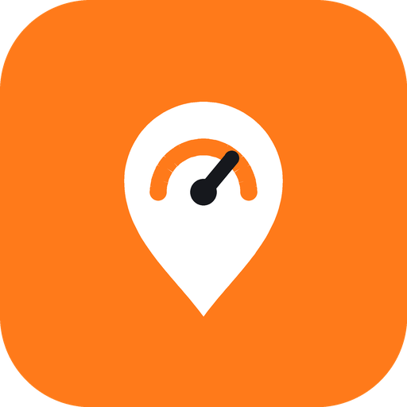

<h1 align="center">Telemet</h1>

<b>Kostenlose GPS-Telemetrie für DJI Osmo Action Kameras. Nutze dein Android-Handy statt der DJI GPS-Bluetooth-Fernbedienung.</b>

[English](../README.md) · [Türkçe](README.tr.md) · [Español](README.es.md) · [Français](README.fr.md) · [Italiano](README.it.md) · **Deutsch** · [Português](README.pt-BR.md) · [简体中文](README.zh-CN.md) · [日本語](README.ja.md) · [한국어](README.ko.md) · [Русский](README.ru.md) · [العربية](README.ar.md)

---

DJI Osmo Action Kameras speichern Geschwindigkeit, Route und Höhe nur dann im Video, wenn die **GPS-Bluetooth-Fernbedienung** von DJI verbunden ist. Telemet macht dein Handy zu dieser Fernbedienung: Es verbindet sich per Bluetooth, sendet das GPS des Handys 10-mal pro Sekunde, und die Kamera schreibt es direkt in die Videodatei. Öffne das Video in **DJI Mimo** oder **DJI Studio** und füge das Dashboard für Geschwindigkeit, Route und Höhe hinzu. Keine FIT-Umwandlung, keine zusätzliche Hardware. Für Motorradfahrer gebaut, funktioniert genauso auf dem Fahrrad, im Auto oder zu Fuß.

## Funktionen

- 📍 **Emuliert die DJI GPS-Fernbedienung**: Daten werden ins Video eingebettet
- 🎬 **Kamerasteuerung**: Aufnahme in der App oder Benachrichtigung starten/stoppen; Modus, Status und Akku
- 🗂️ **Jede Fahrt einzeln**: „Meine Fahrten“ nach Tagen gruppiert mit Strecke, Dauer, Max./Ø-Geschwindigkeit und Anstieg
- 💾 **FIT + GPX-Sicherung jeder Fahrt**: FIT in DJI Studio importieren, falls die Kamera Daten verpasst hat
- 🏍️ **Schräglage und G-Kräfte** aus Gyroskop und GPS, unabhängig davon, wie das Handy montiert ist
- 📈 **Barometrische Höhe** auf Handys mit Barometer
- 🔋 **Läuft wie eine Navi-App**: zeichnet auch bei ausgeschaltetem Bildschirm oder anderer App im Vordergrund weiter auf
- ⚡ **Schneller erster Fix**: GPS wärmt beim Öffnen der App vor; Lücken vor dem Fix und in Tunneln werden gefüllt
- 🌍 **12 Sprachen** · 🔓 **Kostenlos und Open Source**: keine Werbung, kein Konto, kein Internet nötig

## Download und Installation

1. Öffne auf dem Handy die **[neueste Version](https://github.com/avsessisozx/Telemet/releases/latest)**.
2. Tippe auf **Telemet-x.y.z.apk**, lade sie herunter und öffne sie.
3. Warnt Android vor unbekannten Quellen, erlaube die Installation über den Browser oder Dateimanager.
4. Neue Versionen werden über die alte installiert; deine Fahrten bleiben erhalten.

## Schnellstart

1. Aktiviere an der **Kamera** die Drahtlosverbindung. **Schließe DJI Mimo**: Die Kamera spricht immer nur mit einer Fernbedienung.
2. Öffne Telemet. Die Karte **Einrichtung** fragt die nötigen Berechtigungen ab (Standort „Immer zulassen“, Bluetooth, Benachrichtigungen, Akku; bei Xiaomi auch Autostart und Energiesparen).
3. Tippe auf **Starten**. Beim ersten Mal die Verbindung am Kamerabildschirm bestätigen (der Code muss übereinstimmen).
4. Sobald der GPS-Punkt grün ist, die Aufnahme an der Kamera oder in Telemet starten.
5. Am Ende **Stoppen** tippen. Die Fahrt erscheint unter **Meine Fahrten**, die FIT/GPX-Dateien liegen in `Downloads/Telemet`.

## FIT-Sicherung in DJI Studio nutzen

Fahrt aus **Meine Fahrten** auf den Computer teilen → Video in DJI Studio öffnen → **Dashboard** → **Datenquelle** → **FIT-Datei importieren** → bei Bedarf **Zeitabgleich**.

---

Unterstützte Kameras, Sensoren, FAQ und technische Details: [englische Hauptseite](../README.md).

MIT-Lizenz. Dieses Projekt steht in keiner Verbindung zu DJI. DJI, Osmo und Osmo Action sind Marken von SZ DJI Technology Co., Ltd.
